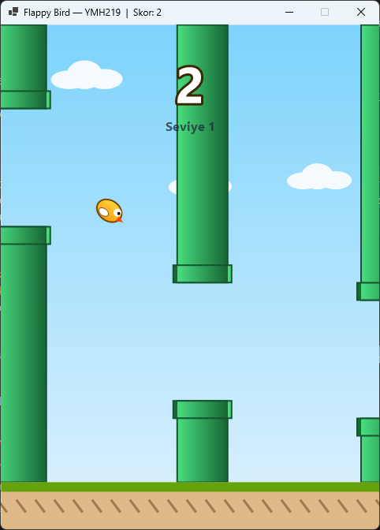
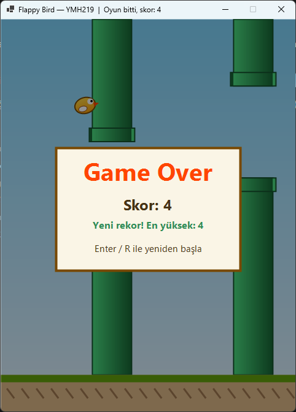
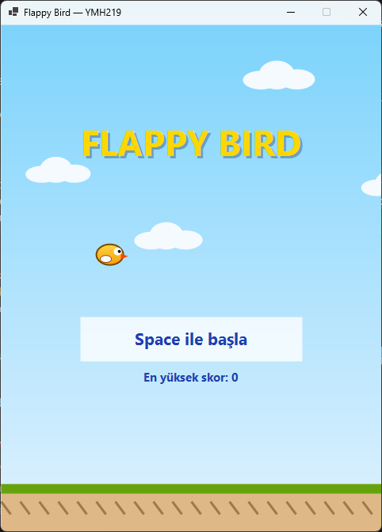
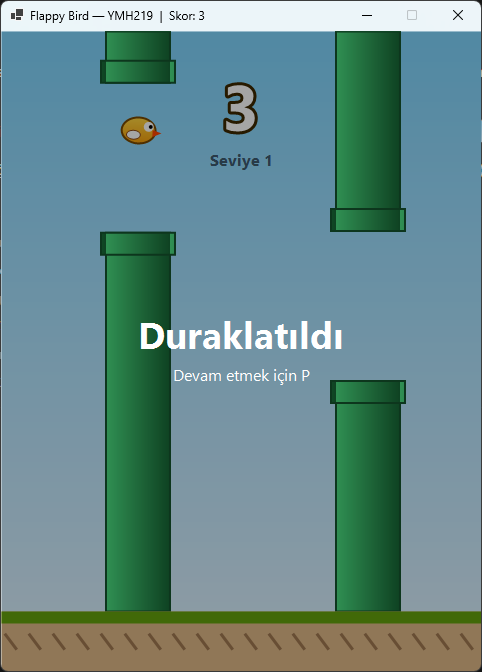

# YMH219-FlappyBird — Windows Forms ile 2D Oyun

Kuşu boşluklardan geçirerek en yüksek skoru yapmaya çalıştığınız, **Windows Forms** ile yazılmış basit bir 2D oyun.
Oyun döngüsü bir `Timer` ile çalışır, her kare çift tamponlu bir panele `Graphics` ile çizilir. Kuş ve engeller ortak bir soyut sınıftan türer.

> YMH 219 Nesne Tabanlı Programlama — Ek Uygulama Ödevi (Windows Forms ile 2D Oyun)

## Ekran Görüntüleri

**Oyun sırasında:** büyük skor yazısı ve seviye göstergesi.



**Game Over:** skor, en yüksek skor (yeni rekorsa yeşil) ve yeniden başlatma bilgisi.



| Hazır ekranı | Duraklatıldı |
|---|---|
|  |  |

## Kullanılan Teknolojiler

- C# / .NET 10 (`net10.0-windows`)
- Windows Forms: `System.Windows.Forms.Timer` (oyun döngüsü), `Paint` olayı, `KeyDown` / `MouseDown`
- `System.Drawing` / `Drawing2D`: `Graphics`, `LinearGradientBrush`, `GraphicsPath` (kenarlıklı skor yazısı), dönüşümler (kuşun eğilmesi)
- `DoubleBuffered` panel ile titremesiz çizim
- `System.IO.File` ile en yüksek skoru dosyada saklama
- Harici NuGet paketi **kullanılmadı**.

## Kurulum ve Çalıştırma

Gereksinim: Windows ve [.NET 10 SDK](https://dotnet.microsoft.com/download) (ya da .NET masaüstü iş yükü kurulu Visual Studio).

**Visual Studio ile:** `YMH219-FlappyBird.slnx` dosyasını açın ve **F5** ile çalıştırın.

**Komut satırı ile:**

```bash
git clone https://github.com/mehmet-furkan/YMH219-FlappyBird.git
cd YMH219-FlappyBird
dotnet run
```

## Kontroller

| Tuş | Ne yapar |
|---|---|
| **Space** / **Yukarı ok** / **Sol tık** | Oyunu başlatır, oynarken kuşu zıplatır |
| **P** | Duraklatır / devam ettirir |
| **Enter** / **R** | Yeni oyun (yeniden başlat) |

## Temel Özellikler

- Yer çekimi ve zıplama fiziği; kuş hızına göre yukarı/aşağı eğilir
- Sağdan sola kayan, boşluk yüksekliği rastgele değişen engeller (ekrandan çıkan engel sağa yeniden yerleştirilir)
- **Çarpışma:** kuş bir engele veya zemine çarpınca oyun durur, **Game Over** paneli gösterilir
- **Skor:** geçilen her engel 1 puan; ekranın üstünde büyük skor yazısı, pencere başlığında da skor
- **Seviye:** her 5 puanda bir seviye atlanır ve engeller hızlanır
- **En yüksek skor** `%AppData%\YMH219-FlappyBird\enyuksek.txt` dosyasında saklanır; rekor kırılınca "Yeni rekor!" yazısı
- **Hazır** ekranı ("Space ile başla"), **duraklatma** ekranı

## Nesne Tabanlı Yapı

```
Models/
  OyunNesnesi.cs   → soyut sınıf: X, Y, Genislik, Yukseklik, virtual Sinirlar, abstract Ciz(Graphics)
  Kus.cs           → OyunNesnesi'nden türer: yer çekimi, Zipla(), Guncelle(), kendi Ciz() ve daha küçük çarpışma kutusu (override Sinirlar)
  Engel.cs         → OyunNesnesi'nden türer: üst/alt sütun, Kaydir(), YenidenKonumlandir(), Carpisiyor(), Gecildi
Services/
  Oyun.cs          → oyunun kuralları ve durumu: Durum (Hazir/Oynaniyor/Duraklatildi/Bitti), Skor, Seviye, Hiz, EnYuksekSkor;
                     Tik(), Zipla(), DuraklatVeyaDevamEt(), YenidenBaslat(); SkorDegisti ve OyunBitti olayları
  SkorDeposu.cs    → en yüksek skoru dosyadan okur/yazar; dosya yoksa, bozuksa veya erişilemezse oyun çökmez
OyunPaneli.cs      → DoubleBuffered Panel
AnaForm.cs         → Timer tikinde Oyun.Tik() + Invalidate(); Paint'te çizim; tuşları Oyun'a iletir
```

- **Kalıtım:** `Kus` ve `Engel`, `OyunNesnesi` soyut sınıfından türer; konum/boyut ortak.
- **Çok biçimlilik:** her nesne `Ciz(Graphics)` metodunu kendine göre yazar; `Kus` ayrıca `Sinirlar` özelliğini override eder.
- **Kapsülleme:** konum ve hız `protected set` / `private set`; dışarıdan sadece metotlarla (`Zipla`, `Kaydir`) değişir.
- **Olaylar:** `Oyun` formu tanımaz; form `SkorDegisti` ve `OyunBitti` olaylarına abone olup başlığı günceller.
- Form iş mantığı içermez: çarpışma, skor, seviye ve rekor kuralları `Oyun` sınıfındadır.

## Bilinen Sınırlamalar / Geliştirme Notları

- Hareket kare başına sabit adımlarla hesaplanır; bilgisayar yavaşlarsa oyun da yavaşlar (zaman tabanlı `deltaTime` kullanılmadı).
- Pencere boyutu sabittir (480×640); yeniden boyutlandırma desteklenmez.
- Ses efekti ve sprite görselleri yoktur; tüm çizim `Graphics` ile kod üzerinden yapılır.
- Kuş tavana çarparsa oyun bitmez, sadece tavanda durur.
- Olası geliştirme: zorluk seçimi, ses efektleri, skor tablosu (ilk 5).

## Öğrenci

**Mehmet Furkan Akyar** — 240541056
